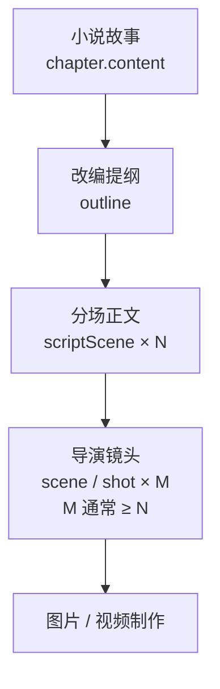

# 小说 → 改编提纲 → 分场正文 → 导演分镜：概念与对应关系

日期：2026-10-26。状态：现行概念说明（面向使用与评审）。  
实现与验收细节见 [structured_screenplay_module_2026-09-28.md](./structured_screenplay_module_2026-09-28.md)。

## 1. 一句话

NovaStory 把创作拆成 **四层事实源**。上层规划下层，下层可以拆细，**数字不必相等**。

```text
小说故事（章）
    ↓ 改编
改编提纲（规格书）
    ↓ 戏剧化
分场正文（scriptScene：一场戏）
    ↓ 分镜
导演镜头（scene / shot：一个机位画面）
    ↓ 制作
图片 / 视频
```

## 2. 各层是什么

| 层 | 页面 | 存什么 | 典型单位 | 持久化 |
| --- | --- | --- | --- | --- |
| 小说故事 | 小说故事 | 章节正文、章纲、规划 | 一章一篇正文 | `chapter` |
| 改编提纲 | 短剧分场剧本 ·「改编提纲」Tab | 一句话梗概、必保事件、戏剧节拍、结尾钩子 | 一章一份提纲 | `chapter_script.document.outline` |
| 分场正文 | 短剧分场剧本 ·「分场正文」Tab | 地点 + 动作 / 对白 / 旁白 / 音效块 | **一场戏** `scriptScene` | `chapter_script.document.scenes[]` |
| 导演分镜 | 导演分镜工作台 | 景别、机位、时长、镜头契约、提示词、图/视频 | **一个镜头** `scene` | `scene` + `scene_version` |

补充：

- **场景地点与道具** 是剧本文档内的轻量目录，供分场引用，不是另一条故事线。
- **小说原文对照** 是只读来源，用来核对改编，不等于改编提纲。
- **剧本页布局**：默认「剧本」Tab 为左右分栏——左改编提纲、右分场正文（提纲可收起）；「场景地点与道具」仍为独立 Tab。

## 3. 必须分清的两个「场」

产品与代码里都叫「场」，但不是同一概念：

| 名称 | 英文 / 代码 | 含义 | 例子 |
| --- | --- | --- | --- |
| 戏剧分场 | `scriptScene` | 剧本里的一场戏（时间地点相对连续的戏剧单元） | 初章有 5 场：`sc_1` … `sc_5` |
| 分镜镜头 | `scene`（导演 Timeline） | 一个机位画面 / 一条时间轴镜头 | 初章可能有 14 个镜头 |

**关系是一对多，不是一一对应：**

```text
1 个 scriptScene（一场戏）
  └─ 多个 scene（多个镜头）
       每个镜头的 shot_spec.source 回指
       script_id / script_revision / script_scene_id / block_ids
```

因此剧本页角标「分场正文 (5)」与导演页「14 镜头」可以同时正确：前者是戏剧分场数，后者是镜头数。

## 4. 整章流水线（建议操作顺序）

以「一章」为制作单元（首期：一章一份当前剧本，不跨章合集）。

1. **小说故事**  
   写好并保存本章正文（可选定稿、更新世界观）。

2. **生成 / 编辑改编提纲**  
   在剧本页生成提纲候选 → 人工核对必保事件与节拍 → 采纳。  
   提纲回答：这章短剧要保住哪些冲突、转折和钩子。

3. **生成 / 编辑分场正文**  
   按已采纳提纲生成分场候选，或手写场次。  
   每场包含可表演的 action / dialogue / voiceover；小说心理活动要外化为动作、对白或旁白。  
   动作块 **不写** 机位、景别、英文生图 Prompt（那些属于导演层）。

4. **确认剧本**  
   至少一场戏才能确认；只有提纲不能交给导演制作。  
   确认后形成可交接版本；之后改小说或剧本，已有分镜会标「来源过期」，不会自动冲掉旧镜头图。

5. **导演生成分镜**  
   按分场把戏拆成镜头契约；台词/旁白按 block 装配；动作可拆成多镜。  
   向空 Timeline 采纳后，进入现有出图 / 视频管线。



## 5. 对应关系怎么查

| 你想确认… | 看哪里 |
| --- | --- |
| 这章有几场戏 | 剧本页「分场正文」角标，或 `document.scenes.length` |
| 这章有几个镜头 | 导演页分镜板镜头数，或 `scene` 表按 `chapter_id` 计数 |
| 某镜头来自哪场戏 | 该镜头 `shot_spec.source.script_scene_id`（如 `sc_2`） |
| 某镜头覆盖哪些对白/动作 | `shot_spec.source.block_ids` |
| 提纲事件有没有写进戏里 | 分场的 `coveredEventIds` / 覆盖检查（生成与确认门禁） |

示例（概念上）：

```text
初章剧本：5 场戏
  sc_1 玉阶静坐、神镜发烫
    → 镜头 1 大远景建立
    → 镜头 2 神镜特写
  sc_2 春潮升起、镜中见裴雨涵
    → 镜头 3–5 …
  …
导演合计：14 个镜头（均回指 sc_1…sc_5）
```

全书加总时更要分开看：例如三章剧本分场合计 14，导演镜头合计可能是 50+，两者不可直接比大小当 bug。

## 6. 页面数字常见误解

| 看到的数字 | 实际含义 | 不要理解成 |
| --- | --- | --- |
| 分场正文 (5) | 当前章戏剧分场数 | 导演镜头数 |
| 分镜板 14 镜头 | 当前章 Timeline 镜头数 | 剧本分场数 |
| 改编提纲里的节拍数 | 戏剧功能段落（开场/升级/钩子等） | 必须等于分场数或镜头数 |
| 场景地点与道具 (14) | 本剧本文档登记的地点+道具条目数 | 分场数或镜头数 |

节拍（beat）与分场（scriptScene）也是规划关系：一个节拍可挂多个必保事件；一场戏可覆盖一个或多个节拍/事件。产品不要求「节拍数 = 分场数 = 镜头数」。

## 7. 和相邻模块的边界

| 模块 | 边界 |
| --- | --- |
| 后续规划（故事页顶栏） | 管开书设定与章节规划候选，不是剧本分场 |
| 场次连续性 | 管入场/出场/持有等状态核对，消费的是已确认剧本与镜头时刻 |
| 构图草稿 / 正式分镜图 | 同一镜头上的制作阶段，不另建一套剧本 |
| 小说直出分镜（旧路径） | 仍可能存在；镜头应标明来源是 chapter 还是 script，避免和剧本产物混淆 |

## 8. 相关文档

| 文档 | 用途 |
| --- | --- |
| [structured_screenplay_module_2026-09-28.md](./structured_screenplay_module_2026-09-28.md) | 剧本模块架构、Schema、候选/确认、导演交接验收 |
| [pronoun_and_visual_fact_best_practices_2026-10-09.md](./pronoun_and_visual_fact_best_practices_2026-10-09.md) | 人物指代与可见事实如何进入分镜 |
| [best_practice_scene_visual_prompt.md](../best_practice_scene_visual_prompt.md) | 镜头契约 → 英文提示词编译 |
| [scene_continuity_workflow_2026-10-09.md](./scene_continuity_workflow_2026-10-09.md) | 连续性状态与分轮制作 |
| [docs/README.md](../README.md) | 文档索引 |
