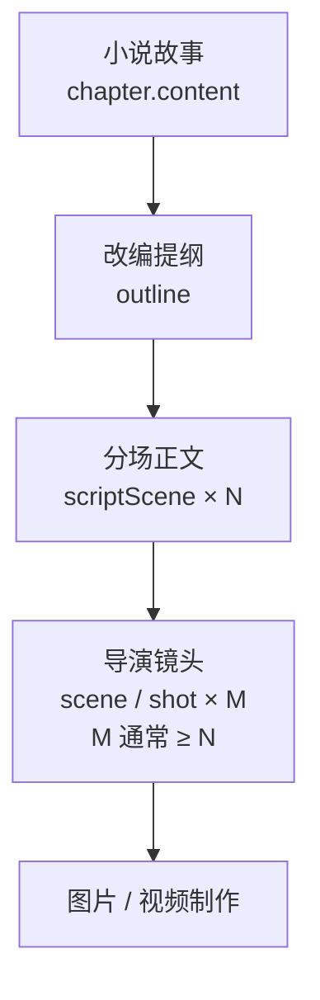
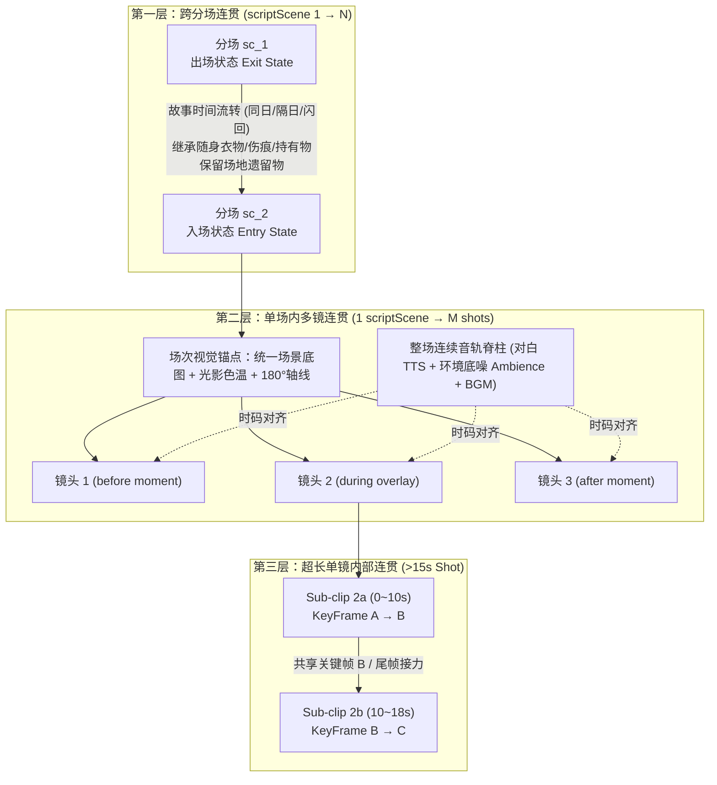

# 小说 → 改编提纲 → 分场正文 → 导演分镜：概念与对应关系

日期：2026-10-26（2026-10-28 增补视听时长规律与三层连贯性机制）。状态：现行概念说明（面向使用与评审）。  
实现与验收细节见 [structured_screenplay_module_2026-09-28.md](./structured_screenplay_module_2026-09-28.md)。

## 1. 一句话

NovaStory 把创作拆成 **四层事实源**。上层规划下层，下层可以拆细，**数字不必相等**。

```text
小说故事（章）
    ↓ 改编
改编提纲（规格书）
    ↓ 戏剧化
分场正文（scriptScene：一场戏）
    ↓ 分镜
导演镜头（scene / shot：一个机位画面）
    ↓ 制作
图片 / 视频
```

## 2. 各层是什么

| 层 | 页面 | 存什么 | 典型单位 | 持久化 |
| --- | --- | --- | --- | --- |
| 小说故事 | 小说故事 | 章节正文、章纲、规划 | 一章一篇正文 | `chapter` |
| 改编提纲 | 短剧分场剧本 ·「改编提纲」Tab | 一句话梗概、必保事件、戏剧节拍、结尾钩子 | 一章一份提纲 | `chapter_script.document.outline` |
| 分场正文 | 短剧分场剧本 ·「分场正文」Tab | 地点 + 动作 / 对白 / 旁白 / 音效块 | **一场戏** `scriptScene` | `chapter_script.document.scenes[]` |
| 导演分镜 | 导演分镜工作台 | 景别、机位、时长、镜头契约、提示词、图/视频 | **一个镜头** `scene` | `scene` + `scene_version` |

补充：

- **场景地点与道具** 是剧本文档内的轻量目录，供分场引用，不是另一条故事线。
- **小说原文对照** 是只读来源，用来核对改编，不等于改编提纲。
- **剧本页布局**：默认「剧本」Tab 为左右分栏——左改编提纲、右分场正文（提纲可收起）；「场景地点与道具」仍为独立 Tab。

## 3. 必须分清的两个「场」

产品与代码里都叫「场」，但不是同一概念：

| 名称 | 英文 / 代码 | 含义 | 例子 |
| --- | --- | --- | --- |
| 戏剧分场 | `scriptScene` | 剧本里的一场戏（时间地点相对连续的戏剧单元） | 初章有 5 场：`sc_1` … `sc_5` |
| 分镜镜头 | `scene`（导演 Timeline） | 一个机位画面 / 一条时间轴镜头 | 初章可能有 14 个镜头 |

**关系是一对多，不是一一对应：**

```text
1 个 scriptScene（一场戏）
  └─ 多个 scene（多个镜头）
       每个镜头的 shot_spec.source 回指
       script_id / script_revision / script_scene_id / block_ids
```

因此剧本页角标「分场正文 (5)」与导演页「14 镜头」可以同时正确：前者是戏剧分场数，后者是镜头数。

## 4. 整章流水线（建议操作顺序）

以「一章」为制作单元（首期：一章一份当前剧本，不跨章合集）。

1. **小说故事**  
   写好并保存本章正文（可选定稿、更新世界观）。

2. **生成 / 编辑改编提纲**  
   在剧本页生成提纲候选 → 人工核对必保事件与节拍 → 采纳。  
   提纲回答：这章短剧要保住哪些冲突、转折和钩子。

3. **生成 / 编辑分场正文**  
   按已采纳提纲生成分场候选，或手写场次。  
   每场包含可表演的 action / dialogue / voiceover；小说心理活动要外化为动作、对白或旁白。  
   动作块 **不写** 机位、景别、英文生图 Prompt（那些属于导演层）。

4. **确认剧本**  
   至少一场戏才能确认；只有提纲不能交给导演制作。  
   确认后形成可交接版本；之后改小说或剧本，已有分镜会标「来源过期」，不会自动冲掉旧镜头图。

5. **导演生成分镜**  
   按分场把戏拆成镜头契约；台词/旁白按 block 装配；动作可拆成多镜。  
   向空 Timeline 采纳后，进入现有出图 / 视频管线。



## 5. 对应关系怎么查

| 你想确认… | 看哪里 |
| --- | --- |
| 这章有几场戏 | 剧本页「分场正文」角标，或 `document.scenes.length` |
| 这章有几个镜头 | 导演页分镜板镜头数，或 `scene` 表按 `chapter_id` 计数 |
| 某镜头来自哪场戏 | 该镜头 `shot_spec.source.script_scene_id`（如 `sc_2`） |
| 某镜头覆盖哪些对白/动作 | `shot_spec.source.block_ids` |
| 提纲事件有没有写进戏里 | 分场的 `coveredEventIds` / 覆盖检查（生成与确认门禁） |

示例（概念上）：

```text
初章剧本：5 场戏
  sc_1 玉阶静坐、神镜发烫
    → 镜头 1 大远景建立
    → 镜头 2 神镜特写
  sc_2 春潮升起、镜中见裴雨涵
    → 镜头 3–5 …
  …
导演合计：14 个镜头（均回指 sc_1…sc_5）
```

全书加总时更要分开看：例如三章剧本分场合计 14，导演镜头合计可能是 50+，两者不可直接比大小当 bug。

## 6. 页面数字常见误解

| 看到的数字 | 实际含义 | 不要理解成 |
| --- | --- | --- |
| 分场正文 (5) | 当前章戏剧分场数 | 导演镜头数 |
| 分镜板 14 镜头 | 当前章 Timeline 镜头数 | 剧本分场数 |
| 改编提纲里的节拍数 | 戏剧功能段落（开场/升级/钩子等） | 必须等于分场数或镜头数 |
| 场景地点与道具 (14) | 本剧本文档登记的地点+道具条目数 | 分场数或镜头数 |

节拍（beat）与分场（scriptScene）也是规划关系：一个节拍可挂多个必保事件；一场戏可覆盖一个或多个节拍/事件。产品不要求「节拍数 = 分场数 = 镜头数」。

## 7. 和相邻模块的边界

| 模块 | 边界 |
| --- | --- |
| 后续规划（故事页顶栏） | 管开书设定与章节规划候选，不是剧本分场 |
| 场次连续性 | 管入场/出场/持有等状态核对，消费的是已确认剧本与镜头时刻 |
| 构图草稿 / 正式分镜图 | 同一镜头上的制作阶段，不另建一套剧本 |
| 小说直出分镜（旧路径） | 仍可能存在；镜头应标明来源是 chapter 还是 script，避免和剧本产物混淆 |

## 8. 视听时长规律与 >15s 拆镜原则

在传统实拍与 AI 视频制片中，需要严格区分三个不同层级的时长概念，避免把「一场戏或一段表演很长」等同于「必须生成一个超长单镜头视频」：

| 概念 | 英文 / 定位 | 典型时长 | 说明 |
| --- | --- | --- | --- |
| 实拍通条 | Master Take | 30s – 180s+ | 实拍现场演员一条演完不断，用于保表演连贯；进入剪辑台后会被切碎 |
| 成片剪辑镜头 | Editorial Shot / `scene` | 电影 3–6s；短剧/漫剧 1.5–4s | 观众在成片里看到的不切机位画面；AI 视频单段超过 6–8s 极易出现物理崩坏、人脸漂移与节奏拖沓 |
| AI 物理生成切片 | Generation Clip | H3 5.0s（120帧）与 8.0s（192帧）双档 | H3 模型按 $17k+5$ 帧数对齐，5s（124→120帧）用于短镜，8s（192帧，$192 \bmod 17 = 5$ 零裁剪）作为主时长档；分镜预算单块硬上限为 15s |

当剧本中某段戏的对白或连续动作超过 8s 时，现行工程架构（详见 [shot_timing_visual_anchor_first_last_frame_spec_2026-10-29.md](./shot_timing_visual_anchor_first_last_frame_spec_2026-10-29.md)）与远期演进区分如下：

1. **解法 A（90% 场景首选：剧本生成按句分块 + 多镜正反打切分）**
   - **现行生产契约（单块单镜）**：当前装配器（`scripts/full-production.mjs`）与覆盖门禁（`validateScriptCoverage`）严格执行「1 个有声块（`block_id`）归属 1 个镜头」。因此，长对白在**剧本生成阶段**即按完整句号拆分为多个 `<= 30` 字（约 8s）的连续 `dialogue` 块，由分镜器按 `8.0s` 软上限将不同有声块分配到相邻的正反打/反应/特写镜头上；若单个不可拆分有声块在 `8s ~ 15s` 之间，则由单镜包络整块语音，生成 8s 视频后由装配器 `tpad=stop_mode=clone` 冻结尾帧对齐实测语音（单条 `AudibleBlock` 跨镜子句切片与 J/L-Cut 声画错位留作远期多轨时间线演进方向）：
     - `镜头 1 (0~6s)`：说话者中景（挂载 `dialogue block 1`）
     - `镜头 2 (6~10s)`：双人/听者同场互动或道具细节（挂载 `dialogue block 2` 或承接下一动作块）
     - `镜头 3 (10~16s)`：切回说话者近景（挂载 `dialogue block 3`）
   - **优势**：既严守单块单镜与 TTS 实测时长装配不变量，又符合短剧高密度视听节奏。

2. **解法 B（10% 场景刚需：跨镜动作接力 —— 8s 整段首尾帧夹逼与末帧抽取）**

   现行落地不引入镜头内嵌 `sub_clips`，而是以 **8.0s（192 帧）整段镜头** 为接力单元（详见 [shot_timing_visual_anchor_first_last_frame_spec_2026-10-29.md](./shot_timing_visual_anchor_first_last_frame_spec_2026-10-29.md)）：
   - **首尾关键帧夹逼（Keyframe Bridge，优先）**：为状态跃迁镜生成 `Before 首帧图` 与 `After 尾帧图`（`last_frame_reference`），有角色时路由至 `minimax_h3_multiframe_official_12gb`（5s 档锚定 `frame 119`，8s 档锚定 `frame 191`），无角色空镜走 `fl2va`；下一镜可直接复用上一镜已采纳的静态尾帧作为首帧（零 VAE 代际衰减）。
   - **视频末帧抽取续拍（Last-Frame Relay）**：当上一镜仅有已完成视频（`narrative_final`）时，精确抽取 `delivery_frames - 1` 帧（119 或 191）作为下一镜候选首帧，限制连续抽帧接力链长 `<= 2` 次。

## 9. 三层连贯性保障机制（单镜内 → 单场多镜 → 跨场）

这一节是分镜连贯性的设计规范，不是当前导演界面已经执行的管线。代码里已经有的是场记账本、`phase` / `time_scope`，以及同刻多机位 `coverage`。下面四把锁中的 Location Master Plate、场内固定的 Screen Direction、整场音轨按镜头时码对齐，以及图中的超长单镜子切片首尾帧接力，都还没有进入 [`ShotContractFieldsSchema`](../../backend/src/schemas/shot_contract.ts)。下一步与 [scene_continuity_workflow_2026-10-09.md](./scene_continuity_workflow_2026-10-09.md) 的「对照现有架构的演进与落地建议」一致。



### 9.1 同一场戏内多个分镜（`1 scriptScene → M shots`）：四把锁

一场戏拆成十几个镜头时，防止「换镜换人、换衣服、换背景、跳轴」的四项核心机制：

1. **视觉锚点锁（Master Visual Anchor）—— 先定场设，再出分镜首帧**
   - 严禁每个分镜仅凭文本独立盲抽（T2I/T2V）。
   - 每场戏开拍前先锁定 **场次环境主图（Location Master Plate，统一空间结构、光源方向、色温、天气）** 与 **本场人物造型卡（Character Variant）**。场内所有镜头首帧均以此为视觉参考生成。
2. **时刻状态机锁（Moment State：`before / during / after`）**
   - 场内状态随动作推进，不能全场共用单一静态状态：
     - **顺序动作分镜**（如：端杯 → 脱手悬空 → 落地摔碎）依次读取 `before`、`during_overlay`、`after` 对应 `moment` 的状态快照；
     - **同刻多机位分镜**（如同一瞬间的全景 + 特写/反应镜 `coverage`）绑定**同一个 `moment_id`**，共享状态而不重复推进事件。
3. **视听轴线与动势锁（180° Axis & Match on Action）**
   - **轴线与朝向（Screen Direction）**：双人对话或对峙戏在场次内固定画面站位与视线方向（如「甲左面右、乙右面左」），无跨轴动作时正反打严格反向，防止视线跳轴。
   - **动势顺接（Match on Action）**：连续动作切镜（如拔剑前半段切剑刃出鞘特写），后一镜首帧构图需承接上一镜末尾姿态与运动方向。
4. **音轨脊柱锁（Continuous Audio Spine）**
   - 整场戏的连贯感高度依赖声音不断：以整场连续的环境底噪（Room Tone / Ambience）与 BGM 铺底，对白/音效按 `audible_blocks` 挂载在时间轴上，支持跨镜声画错位（J-Cut / L-Cut）。

### 9.2 多个分场之间（`scriptScene 1 → scriptScene 2 → ...`）：场记账本

跨场连贯将**故事时间（Story Time）**与**制作顺序（Production Order）**解耦，由场记连续性账本（详见 [scene_continuity_workflow_2026-10-09.md](./scene_continuity_workflow_2026-10-09.md)）驱动：

1. **场间时间关系（Time Scope & Transition Type）**
   - **紧接连续（Continuous）**：如室内夺门而出紧接走廊奔跑，服装、湿度（`wetness`）、手持物（`holder`）、环境天色乃至出入画方向强制继承。
   - **同日稍后（Same Day Later）**：随身衣物、持有物与未修复损伤（`integrity`）继承，瞬态站位清空，天色光影按时间推进。
   - **隔日 / 时间跳跃（Next Day / Time Jump）**：允许按已确认剧情或设计触发换装、休整或状态变更，禁止无依据自动重置。
   - **闪回 / 回忆（Flashback，`branch_id` 分支）**：挂起主线状态，读取回忆时间点快照；闪回结束后下一场恢复主线上一场的 `exit_state`。
2. **随人持久化 vs 随地持久化**
   - **随人走（Character-bound）**：衣物穿戴、湿透/破损状态、随身持有道具跨场地跟随角色延续。
   - **随地留（Location-bound）**：留在某房间的坏门锁（`lock_function=broken`）、地面碎瓷片、关闭的台灯（`power_state=off`）绑定在该 `location` 下；角色离开去往别处时不带走，重返该地点时自动从账本召回。
3. **场间转场钩子（Scene-to-Scene Hook）**
   - 通过**声音先行（J-Cut）**（上一场收尾画面未完、下一场环境音或台词先入）或**视觉匹配剪辑（Match Cut）**（上一场末尾特写与下一场开篇构图/动势呼应）消除场间割裂感。

## 10. 相关文档

| 文档 | 用途 |
| --- | --- |
| [structured_screenplay_module_2026-09-28.md](./structured_screenplay_module_2026-09-28.md) | 剧本模块架构、Schema、候选/确认、导演交接验收 |
| [pronoun_and_visual_fact_best_practices_2026-10-09.md](./pronoun_and_visual_fact_best_practices_2026-10-09.md) | 人物指代与可见事实如何进入分镜 |
| [best_practice_scene_visual_prompt.md](../best_practice_scene_visual_prompt.md) | 镜头契约 → 英文提示词编译 |
| [scene_continuity_workflow_2026-10-09.md](./scene_continuity_workflow_2026-10-09.md) | 连续性状态与分轮制作 |
| [docs/README.md](../README.md) | 文档索引 |
