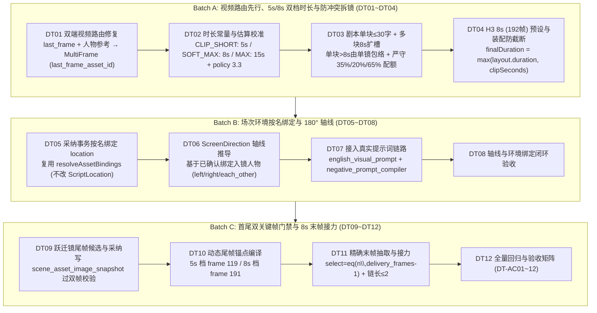

# 视听时长拆镜、场次视觉锚点与首尾帧接力实施方案（v3 终局冻结版）

日期：2026-10-29。状态：现行实施方案（规范与任务事实源，经三轮对抗式评审修订冻结）。  
关联：[novel_to_script_to_storyboard_concepts.md](./novel_to_script_to_storyboard_concepts.md)、[scene_continuity_workflow_2026-10-09.md](./scene_continuity_workflow_2026-10-09.md)、[0_TASKLIST.md](../0_TASKLIST.md#track9-duration-anchor-relay)、[shot_timing_visual_anchor_first_last_frame_tasks_2026-10-29.md](./shot_timing_visual_anchor_first_last_frame_tasks_2026-10-29.md)。

---

## 1. 对抗式技术评审与架构边界红线（Adversarial Review Findings）

基于当前代码库基线（HEAD `256787f`），经对 `backend/src/` 与 `scripts/` 生产装配管线的交叉审计，确立以下 6 条不可突破的工程与数学边界：

### 1.1 H3 物理帧数对齐规律与 5.0s / 8.0s 双档制（纠正“15s 模型上限”误区）
* **代码事实**：
  1. [`storyboard_fact_workflow.ts`](../../backend/src/services/storyboard_fact_workflow.ts#L170) 中的 `MAX_SHOT_SECONDS = 15` 只是**分镜规划器的单镜预算上限**，并非视频模型物理上限；
  2. [`video_spec_compiler.ts`](../../backend/src/services/video/video_spec_compiler.ts#L60-L64) 的 `alignH3FrameCount` 要求模型帧数满足 $17k + 5$（24fps 下：5s 需请求 124 帧再裁成 120 帧；6s 抬升至 158 帧≈6.58s；7s 抬升至 175 帧≈7.29s；**8s 恰好是 192 帧 = 8.000s，且 $192 \bmod 17 = 5$，模型输出与交付成片完全等长、零裁剪**）。
* **架构裁决**：
  - 视频生成不搞“5~8s 任意秒数”，也不搞全量一刀切 8s（192 帧算力开销约为 124 帧的 2 倍），而是确立 **`5.0s`（120 交付帧，尾帧 `119`）与 `8.0s`（192 交付帧，尾帧 `191`）双档按需自动选择**：
    - 短镜（`shot.duration <= 5.0s` 且语音 `<= 5.0s`）用 `5s` 档；
    - 主叙事/对白镜（`shot.duration > 5.0s`）用 `8s` 档；
    - 跨镜长镜头接力统一以 **8.0s（192 帧）整段** 为基本接力单元。

### 1.2 单块单镜铁律与算术防崩（废除 `AudibleBlock` 子句切片）
* **代码事实**：
  1. [`scripts/production-contracts.mjs`](../../scripts/production-contracts.mjs#L20) 的 `validateScriptCoverage`、[`storyboard_generation_service.ts`](../../backend/src/services/ai/storyboard_generation_service.ts#L151) 的 `validateStoryboardCoverage`、[`storyboard_fact_workflow.ts`](../../backend/src/services/storyboard_fact_workflow.ts#L622-L656) 的 `validateFactPayload` 以及 [`scene_production.ts`](../../backend/src/services/scene_production.ts#L75) 四道门禁均强制要求：**每个有声块（`block_id`）只能归属一个镜头，严禁跨镜重复或切碎**；
  2. [`scripts/full-production.mjs`](../../scripts/full-production.mjs#L1190-L1261) 是现成的章节声画装配器，它按 `ffprobe` 实测 TTS 语音时长排列音轨（`timedSpeech`），并用 `tpad=stop_mode=clone` 冻结画面尾帧来对齐长语音，**不读取任何文本字符偏移或估算毫秒**；
  3. 在 [`storyboard_fact_workflow.ts` L1195–L1197](../../backend/src/services/storyboard_fact_workflow.ts#L1195-L1197) 中，若单场只有 1 个 10s 对白块 `b1`（`budget.duration = 10`）却强行拆成 2 镜，镜头 0 分到 10s、镜头 1 无声保底 1s，总和 `11 > 10` 会立即触发 `有声对齐时长冲突` 崩溃，且在逐镜混音时导致镜头 1 变成死寂哑剧。
* **架构裁决**：
  1. **废除 `AudibleBlock` 子句切片字段（`span_start/end`、`time_offset_ms`）与 `sub_clips`**；
  2. **多句长对白在剧本生成阶段解决**：在剧本生成 Prompt 中约束单条 `dialogue` / `voiceover` 块控制在 **30 字（约 8 秒）以内**，长独白在生成剧本时按完整句号拆为连续多个 `dialogue` 块，天然实现“一块一镜、正反打切分”；
  3. **单块 >8s 语音包络与尾帧冻结**：分镜器仅在分场存在**多个有声块或多个独立视觉节拍**时按 `SOFT_MAX_SHOT_SECONDS = 8.0s` 扩充镜头槽位；若单个有声块自身 `> 8.0s`（且 `<= 15.0s`），由单镜完整包络该块时长，成片阶段生成 8s 视频后由装配器 `tpad` 冻结尾帧补齐实测语音。

### 1.3 装配器防截断修复：防止 8s 视频被短语音砍掉尾帧
* **代码事实**：[`scripts/full-production.mjs` L1190、L1259–L1260](../../scripts/full-production.mjs#L1259-L1260) 当前写死 `tpad=...:stop_duration=${Math.max(0, duration - 5)}` 且在 L1190 用 `Math.max(5, shot.duration)` 计算 `layout.duration`。当镜头实际生成了 **8.0s（192 帧）** 视频，而 `layout.duration` 为 6.0s 时，L1260 的 `-t ${duration}` 会强行截断第 144~191 帧（最后 2 秒动作及第 191 帧尾帧锚点被直接砍掉）。
* **防御设计**：装配器读取视频源文件实测时长 `clipSeconds = Number(info.format.duration) || 5`，取 `finalDuration = Math.max(layout.duration, clipSeconds)`，以 `Math.max(0, finalDuration - clipSeconds)` 计算 `tpad`，并以 `finalDuration` 作为 `-t`、`atrim` 及章节时码累加基准。

### 1.4 章节景别配额与入镜人物绑定铁律
* **代码事实**：
  1. [`shot_intent_quota.ts`](../../backend/src/services/shot_intent_quota.ts#L95-L187) 的真实门禁为：`establish + wide-action >= 35%`、`insert + reaction <= 20%`、单一类型 `< 65%`（不存在所谓“80% 配额”）；
  2. [`storyboard_fact_workflow.ts` L1087–L1100](../../backend/src/services/storyboard_fact_workflow.ts#L1087-L1100) 在翻译前按序号冻结全章景别，且 L628 强制要求 `spec.visible_subjects` 严格等于所选视觉事实已确认绑定（`boundVisibleEntities(f.binding)`）的人物集合。
* **防御设计**：
  - 严禁凭空捏造不在 `fact.binding` 中的“听者入镜”，也严禁把特写改标为 `medium-action` 作弊绕过门禁；
  - 仅当本镜头所引用的 `fact_ids` / `hold_fact_ids` 已绑定双人/多人入镜，或切换到听者自身的动作事实块时，才允许对应人物入镜；景别统一在 L1087 槽位冻结阶段合规分配。

### 1.5 视频路由双端漏洞修复与 Multi-Frame 原生尾帧槽位
* **代码事实**：
  1. [`backend/src/schemas/video.ts`](../../backend/src/schemas/video.ts#L156-L163) 规定 `minimax_h3_fl2va_official_12gb` 严禁传入 `character_reference_asset_ids`；而 `minimax_h3_multiframe_official_12gb` 的 manifest 与 [`video_workflow_compiler.ts` L203–L210](../../backend/src/services/video/video_workflow_compiler.ts#L203-L210) **原生自带 `last_frame` 槽位（节点 22/23）**，无需借道 `guide_frames`；
  2. 当前前端 [`services/videoWorkflowPolicy.ts`](../../services/videoWorkflowPolicy.ts#L26-L28) 的 `recommendVideoWorkflow` 与生产脚本 [`scripts/production-references.mjs`](../../scripts/production-references.mjs#L197-L200) 的 `chooseShotVideoStrategy` 均存在同一个漏洞：只要有 `last_frame_reference` 就无脑选 `fl2va`，导致 [`full-production.mjs` L885/L924](../../scripts/full-production.mjs#L885) 把人物参考图清空为 `[]`。
* **防御设计**：双端同步修复路由——当同时存在 `last_frame_reference` 与人物参考（`character_reference` 或镜头已解析出主键人物）时，强制路由至 **`minimax_h3_multiframe_official_12gb`** 并传入 `last_frame_asset_id`（保留 1~3 张 `character_reference_asset_ids`）；仅纯空镜/无人物尾帧镜头走 `fl2va`。

### 1.6 契约版本迁移与剧本哈希隔离
* **代码事实**：[`storyboard_fact_workflow.ts` L566、L611、L631](../../backend/src/services/storyboard_fact_workflow.ts#L566) 对整份 `ScriptDocument`、预算和负向词做严格哈希比对。
* **防御设计**：
  1. 调整时长估算器或负向词编译器时，同步将 [`storyboard_facts.ts`](../../backend/src/schemas/storyboard_facts.ts#L4) 的 `FACT_POLICY_VERSION` 从 `'storyboard-facts-3.2'` 升级为 `'storyboard-facts-3.3'`；
  2. **不在 `ScriptLocationSchema` 中写入 `library_asset_id`**（避免每次绑定地点资产都篡改剧本哈希使全章事实契约失效），直接复用 [`production-references.mjs` `resolveAssetBindings`](../../scripts/production-references.mjs#L7-L50) 按地点名称唯一匹配 `library_asset(kind='location')`；
  3. 180° 轴线提示词必须接入运行时真正调用的 [`english_visual_prompt.ts`](../../backend/src/services/english_visual_prompt.ts) / [`scene_visual_prompt_service.ts`](../../backend/src/services/scene_visual_prompt_service.ts) 与 [`negative_prompt_compiler.ts`](../../backend/src/services/negative_prompt_compiler.ts)（`pony_prompt_compiler.ts` 仅作纯函数单测辅助）。

---

## 2. 三大批次数据契约与详细设计



### 2.1 Batch A：视频路由先行、5s/8s 双档时长模型与防冲突拆镜

#### 2.1.1 双端视频工作流路由修复（DT01）
在 [`services/videoWorkflowPolicy.ts`](../../services/videoWorkflowPolicy.ts)（`recommendVideoWorkflow`）与 [`scripts/production-references.mjs`](../../scripts/production-references.mjs)（`chooseShotVideoStrategy`）同步修正：
- 存在 `guide_frame_reference` / `composition_reference` → `minimax_h3_multiframe_official_12gb`；
- 存在 `last_frame_reference` **且存在人物参考**（`character_reference` 或已绑定角色）→ `minimax_h3_multiframe_official_12gb`（通过 `last_frame_asset_id` 注入节点 22/23，保留 `character_reference_asset_ids`）；
- 存在 `last_frame_reference` **且无人物参考** → `minimax_h3_fl2va_official_12gb`。

#### 2.1.2 三级时长定义與台词估算校准（DT02）
在 [`storyboard_fact_workflow.ts`](../../backend/src/services/storyboard_fact_workflow.ts) 中定义：
```ts
export const CLIP_SECONDS_SHORT = 5.0;       // H3 短镜档（124 模型帧 → 120 交付帧）
export const SOFT_MAX_SHOT_SECONDS = 8.0;    // H3 主时长档（192 模型帧 = 192 交付帧）兼多块拆镜软上限
export const MAX_SHOT_SECONDS = 15.0;        // 单镜单块语音预算硬上限
```
估算器 `estimateAudioSeconds(block)` 在保留 `spokenCharacters(block)`（仅统计对话引号内文本）的基础上，将连续省略号 `……` 归并为单次停顿，避免重复累加；同步将 `FACT_POLICY_VERSION` 升至 `'storyboard-facts-3.3'`。

#### 2.1.3 防算术崩溃的槽位分配与 120s 章节预算演算（DT03）
- **120s 章节镜头数演算**：按 `SOFT_MAX_SHOT_SECONDS = 8.0s` 计算，$\lceil 120 / 8 \rceil = 15$ 个基础槽位，叠加独立视觉节拍与状态互斥槽位（+6~10 镜）后全章共 **21~25 镜**，在 `STORYBOARD_CANDIDATE_SHOT_LIMIT = 35` 下留有 10~14 镜安全裕度。
- **防 L1197 算术崩溃**：
  - 当分场包含多个有声块或多个视觉节拍时，按 `SOFT_MAX_SHOT_SECONDS (8.0s)` 扩充槽位；
  - 若单个有声块 `b` 的 `audioSeconds(b) > 8.0s`（且 `<= 15.0s`），该块所在的镜头槽位允许包络 `audioSeconds(b)`，**严禁为单个未切分有声块凭空拆出无声伴随槽位**；
  - 景别意图维持在 L1087 槽位冻结阶段分配，严守 `establish + wide-action >= 35%`、`insert + reaction <= 20%`、单一类型 `< 65%`。

#### 2.1.4 H3 8.0s（192 帧）预设与装配防截断（DT04）
1. 在 [`schemas/video.ts`](../../backend/src/schemas/video.ts) 扩充 `VideoPresetSchema`：`['preview_480p_5s', 'standard_720p_5s', 'preview_480p_8s', 'standard_720p_8s']`；
2. 5s 档交付 `120` 帧（末帧索引 `119`），8s 档交付 `192` 帧（末帧索引 `191`）；
3. 在 [`scripts/full-production.mjs`](../../scripts/full-production.mjs) 中，取 `clipSeconds = Number(info.format.duration) || 5` 与 `finalDuration = Math.max(layout.duration, clipSeconds)`，以 `Math.max(0, finalDuration - clipSeconds)` 计算 `tpad`，杜绝 8s 视频被短语音截断。

---

### 2.2 Batch B：场次环境资产按名绑定与 180° 轴线契约

#### 2.2.1 场次环境资产按名自动绑定（DT05）
不修改 `ScriptLocationSchema`（保持剧本 `factSourceHash` 稳定）。在分镜采纳事务中复用 [`scripts/production-references.mjs`](../../scripts/production-references.mjs#L7-L50) 的归一化同名唯一匹配规则：若镜头 `spec.location` 唯一匹配到当前项目下 `status = 'completed'` 且有 `image_url` 的 `library_asset(kind = 'location')`，自动写入 `scene_asset_reference`。

#### 2.2.2 180° 轴线契约与真实提示词链路编译（DT06 ~ DT08）
在 [`shot_contract.ts`](../../backend/src/schemas/shot_contract.ts) 的 `ShotContractFieldsSchema` 扩展：
```ts
export const ScreenDirectionSchema = z.object({
  subject_placement: z.enum(['left', 'center', 'right', 'two-shot-left-right']).optional(),
  facing_direction: z.enum(['left', 'right', 'each_other', 'camera', 'away']).optional(),
  camera_side: z.enum(['axis_a', 'axis_b']).default('axis_a'),
});
```
- **推导规则**：仅从本场视觉事实**已确认绑定（Confirmed Binding）**的入镜人物推导：第 1 主体默认 `left + facing right`，第 2 主体默认 `right + facing left`，双人同框默认 `two-shot-left-right + facing each_other`（不用 `camera`，避免与 `medium-action` 的 `looking at viewer` 负向词冲突）。
- **编译落点**：接入运行时真实调用的 [`english_visual_prompt.ts`](../../backend/src/services/english_visual_prompt.ts) / [`scene_visual_prompt_service.ts`](../../backend/src/services/scene_visual_prompt_service.ts) 与 [`negative_prompt_compiler.ts`](../../backend/src/services/negative_prompt_compiler.ts)。

---

### 2.3 Batch C：首尾双关键帧门禁与 8s 整段末帧接力

#### 2.3.1 尾帧候选采纳与角色快照门禁（DT09 ~ DT10）
- 状态跃迁镜头的尾帧静图（`last_frame_reference`）生成后，必须走候选采纳并调用 [`recordShotMasterSnapshot`](../../backend/src/services/video/shot_master_snapshot.ts#L59) 写入 `scene_asset_image_snapshot`；
- 进入视频预检前，首帧与尾帧双双通过 [`validateShotMasterCharacters`](../../backend/src/services/video/shot_master_snapshot.ts#L92) 校验；
- `video_workflow_compiler.ts` 将尾帧动态锚定在 `delivery_frames - 1`（5s 档为 `119`，8s 档为 `191`）。

#### 2.3.2 精确末帧抽取与跨镜接力（DT11）
在 [`media_asset_service.ts`](../../backend/src/services/video/media_asset_service.ts) 新增 `relayKeyframeFromPreviousShot(targetSceneId, sourceSceneId)`：
- 若上一镜有已采纳的静态尾帧（`last_frame_reference`），优先直接复用该静态图（零 VAE 代际画质损耗）；
- 若从上一镜已完成视频（`narrative_final`）抽帧，使用 `ffmpeg -vf "select=eq(n\,${deliveryFrames - 1})" -frames:v 1` 精确提取最后 1 帧，记录 `parent_asset_id` 与 `relay_depth`（限制 `relay_depth <= 2`），并写入 `scene_asset_image_snapshot` 快照。

---

## 3. 验收矩阵（Acceptance Matrix：DT-AC01 ~ DT-AC12）

| 编号 | 测试场景与输入 | 必须观察到的结果与硬断言 |
| :--- | :--- | :--- |
| **DT-AC01** | 有尾帧（`last_frame_reference`）且有人物参考的镜头执行视频路由决策（前端与 CLI 双端） | `recommendVideoWorkflow` 与 `chooseShotVideoStrategy` 均返回 `minimax_h3_multiframe_official_12gb` 并携带 `last_frame_asset_id`，`character_reference_asset_ids` 完整保留；纯空镜有尾帧返回 `fl2va`。 |
| **DT-AC02** | 台词时长估算器输入含引号对白、连续省略号 `……` 及急促/缓慢 `delivery` | 仅统计引号内可发音字符，连续 `……` 不重复计停顿；`FACT_POLICY_VERSION` 升至 `storyboard-facts-3.3`。 |
| **DT-AC03** | 包含多个 `<= 8s` 对白块的长分场（总语音 18s）与包含单个 `12s` 对白块的分场分别执行 `allocateBudgets` 与时长分配 | 多块长分场自动扩充为 3 镜（每镜 5~7s）；单块 12s 分场由单镜包络 12s（不抛 L1197 `有声对齐时长冲突`，不产生静音空镜）；120s 章节总镜数 <= 35，且 100% 通过 `assertChapterShotQuota`（35% / 20% / 65%）。 |
| **DT-AC04** | H3 `standard_720p_8s` 预设编译与 `full-production.mjs` 装配（8s 视频配 6s 语音 vs 8s 视频配 11s 语音） | 8s 预设编译出 `frames = 192`、尾帧锚点 `191`；配 6s 语音时装配成片保持 `8.0s`（不截断 6~8s 动作）；配 11s 语音时 `tpad` 冻结末尾 `3.0s` 至 `11.0s`。 |
| **DT-AC05** | 剧本分场 `location` 名称匹配已完成生图的 `library_asset(kind='location')`，执行分镜采纳 | 不修改 `ScriptLocationSchema`；采纳后 `scene_asset_reference` 自动写入对应 `(scene_id, asset_id, asset_revision)`。 |
| **DT-AC06** | 双人对话分场（已确认绑定角色 A 与角色 B）生成分镜契约 | 角色 A 单人镜推导为 `left + facing right`，角色 B 单人镜为 `right + facing left`，双人同框为 `two-shot-left-right + facing each_other`，正反打视线严格互斥。 |
| **DT-AC07** | 带有 `screen_direction` 的镜头通过 `english_visual_prompt` 与 `negative_prompt_compiler` 编译 | 运行时正向提示词包含朝向构图描述；负向提示词包含反向视线抑制词，且双人镜不与 `looking at viewer` 冲突。 |
| **DT-AC08** | 状态跃迁镜头生成尾帧静图并执行采纳与视频预检 | 尾帧采纳时写入 `scene_asset_image_snapshot`，首尾双帧均通过 `validateShotMasterCharacters` 角色版本一致性校验。 |
| **DT-AC09** | 5s 档与 8s 档下的 Multi-Frame 尾帧编译测试 | 5s 档尾帧锚定于 `frame_idx = 119`；8s 档尾帧锚定于 `frame_idx = 191`，引导帧允许范围扩展至 `1..delivery_frames-1`。 |
| **DT-AC10** | 对已完成视频的镜头执行 `relayKeyframeFromPreviousShot`（含静态尾帧优先与视频末帧抽取） | 精确抽取 `delivery_frames - 1` 帧，写入快照与 `parent_asset_id`；当接力深度 `relay_depth > 2` 时明确拒绝并提示生成新关键帧静图。 |
| **DT-AC11** | 项目复制、导出与导入测试（含 `screen_direction` 等新契约字段） | 导出 JSON 与导入还原无损，所有引用、快照与版本号完整保留。 |
| **DT-AC12** | 全栈静态检查与全量测试门禁 | 新增测试全部登记进 `backend/scripts/run-tests.ts`；`npm run check`、`npm --prefix backend run test:full`、`node --test scripts/full-production.test.mjs` 全部 0 错误通过。 |
