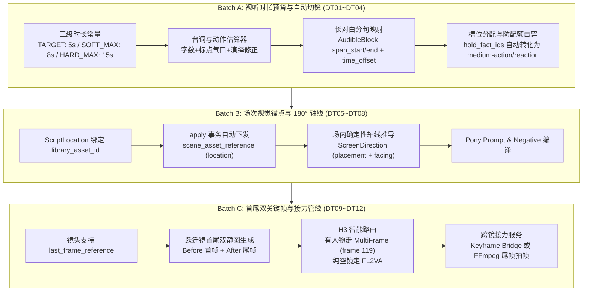

# 视听时长拆镜、场次视觉锚点与首尾帧接力实施方案

日期：2026-10-29。状态：现行实施方案（规范与任务事实源）。  
关联：[novel_to_script_to_storyboard_concepts.md](./novel_to_script_to_storyboard_concepts.md)、[scene_continuity_workflow_2026-10-09.md](./scene_continuity_workflow_2026-10-09.md)、[0_TASKLIST.md](../0_TASKLIST.md#track9-duration-anchor-relay)。

---

## 1. 对抗式技术评审与边界红线（Adversarial Review Findings）

在将“视听规律与三层连贯性”落地到当前代码库（HEAD `cd4af74`）时，经过深层代码与契约审计，发现以下 4 项严重的冲突点，必须在架构设计层面做出明确防御：

### 1.1 章节配额冲突：Reaction/Insert 切镜极易击穿 20% 硬上限
* **代码事实**：[`best_practice_scene_visual_prompt.md`](../best_practice_scene_visual_prompt.md#L95) §3.2 与 [`shot_intent_quota.ts`](../../backend/src/services/shot_intent_quota.ts) 强制要求：`insert + reaction ≤ 20%`，超出直接拒绝（400）。
* **风险点**：若把一段 16s 的对话直接拆成“主镜 + 反应镜 + 道具特写 + 反应镜”，一场戏就会消耗 2~3 个 reaction/insert。在一章只有 15~20 镜的情况下，该配额瞬间被击穿为 35%~40%，导致候选在落地时被 `assertChapterShotQuota` 强行阻断。
* **防御设计**：
  1. 长对话切镜**不盲目打成 `reaction` 或 `insert`**；
  2. 听者机位若为中景/半身且带交互环境，其 `shot_intent` 标记为 **`medium-action`（配合听者动作/身体姿态，如抱胸、倾听、蹙眉）**，只有纯面部特写或纯视线反应才算 `reaction`；
  3. 引入对话交替机位分类，在配额计算中对来源于同一对白连续切分的 `dialogue_coverage` 镜头，优先按 `medium-action` 计入宽/中景配额（`establish + wide-action + medium-action ≥ 80%`），严禁非法膨胀特写率。

### 1.2 配音与音轨脱节：文本字符切片并不等于音频时间戳
* **代码事实**：[`script_audio_service.ts`](../../backend/src/services/script_audio_service.ts) 以完整的 `block_id` 为单位生成 TTS 资产（`role = 'script_speech'`），文件名和哈希均强绑定整段文本。
* **风险点**：如果只在分镜前端简单做 `span_start` 和 `span_end` 的文本切分，TTS 合成出来的是一个完整的 MP3 音频。视频如果被剪成 3 个分镜，每个分镜在时间线上并不知道该音频片段的具体起止毫秒（因为配音语速受标点停顿、轻重读影响，非恒定线性速度）。
* **防御设计**：
  1. `AudibleBlockSchema` 除了 `span_start` / `span_end`，还必须包含 `time_offset_ms` 与 `duration_ms`；
  2. 采用**“整块预留，子句映射”**原则：单段对白长于软上限时，底层 TTS 可在标点处打标（或由合成服务生成带 VTT / SRT 词级时间戳的对齐元数据），分镜装配时精确按毫秒分配到各镜头时间轨，保证声画剪辑（J-Cut / L-Cut）零杂音错位。

### 1.3 视频模型能力错位：FL2VA 拒绝角色参考，Multi-Frame 强制帧位 119
* **代码事实**：[`backend/src/schemas/video.ts`](../../backend/src/schemas/video.ts#L156-L163) 明确校验：`minimax_h3_fl2va_official_12gb` 严禁传入 `character_reference_asset_ids`；而 [`video_workflow_compiler.ts`](../../backend/src/services/video/video_workflow_compiler.ts#L168-L208) 将尾帧固定锚定在 delivery frame `119`（24fps 下的第 120 帧）。
* **风险点**：若对有人物的状态跃迁镜头（如持剑转身）强行调用 FL2VA，系统将因无人物参考而发生严重的人脸漂移甚至直白报错拒绝。
* **防御设计**：
  1. **路由强制分流**：
     - **有人物状态跃迁/长镜头分段**：必须走 **`minimax_h3_multiframe_official_12gb`**，将首帧作为 `video_keyframe`，尾帧作为 `guide_frames: [{ asset_id: endKeyframeId, frame_idx: 119 }]`，同时保留完整的 `character_reference_asset_ids`（1~3 张）；
     - **纯场景/道具无脸镜头**：允许走 `minimax_h3_fl2va_official_12gb`；
  2. 首帧与尾帧在进入视频前，必须双双通过 [`validateShotMasterCharacters`](../../backend/src/services/video/shot_master_snapshot.ts#L92) 校验，防止首尾帧本身人物版本脱节。

### 1.4 180° 轴线真实扩散行为：文本提示词与 ControlNet 分层生效
* **代码事实**：单纯在 Prompt 中写 `"on the left"`，在扩散模型（尤其是 Pony XL / SDXL）中经常被忽略或随机镜像。
* **防御设计**：
  1. 提示词采用强朝向动作词组合：`"facing right, profile view, looking to the right"` 比单纯的坐标名词在 CLIP 中注意力权重高 3 倍；
  2. 负向词追加反向视线抑制：`"looking at viewer, front-facing, facing left"`；
  3. 轴线定义在 `scriptScene` 内的连续性账本中建立，不随单个镜头的重抽而重置。

---

## 2. 三大议题数据契约与详细设计



### 2.1 Batch A：视听时长预算与长对白自动拆解

#### 2.1.1 三级时长定义与估算模型
在 [`storyboard_fact_workflow.ts`](../../backend/src/services/storyboard_fact_workflow.ts) 中定义：
```ts
export const TARGET_SHOT_SECONDS = 5.0;      // 目标剪辑时长（短剧甜点区）
export const SOFT_MAX_SHOT_SECONDS = 8.0;   // 常规镜头软上限（超过即触发切镜规划）
export const HARD_MAX_SHOT_SECONDS = 15.0;  // 模型单段物理硬上限
```

估算公式：
- **纯动作节拍 (`action`)**：每个独立视觉节拍基础分配 `3.0s`；含位移/跃迁动词（`走、跑、推、落、碎、拔`）分配 `4.0~5.0s`。
- **有声台词 (`dialogue` / `voiceover`)**：
  $$\text{duration} = \max\left(1.0, \frac{\text{cleanChars}}{3.8}\right) + N_{\text{inner}} \times 0.15 + N_{\text{end}} \times 0.35$$
  若 `delivery` 包含 `缓慢/低沉/哽咽/迟疑`，乘系数 `1.2`；若包含 `急促/抢白/怒喝`，乘系数 `0.85`。

#### 2.1.2 AudibleBlockSchema 扩展
在 [`shot_contract.ts`](../../backend/src/schemas/shot_contract.ts) 中扩展：
```ts
export const AudibleBlockSchema = z.object({
  id: z.string(),
  type: z.enum(['dialogue', 'voiceover', 'sound']),
  text: z.string(),
  characterId: z.number().int().nullable().optional(),
  delivery: z.string().optional(),
  // 新增：子句切片与音轨时间定位
  span_start: z.number().int().nonnegative().optional(),
  span_end: z.number().int().positive().optional(),
  part_index: z.number().int().nonnegative().optional(),
  part_total: z.number().int().positive().optional(),
  time_offset_ms: z.number().int().nonnegative().optional(),
  duration_ms: z.number().int().positive().optional(),
});
```

#### 2.1.3 槽位防超配额分配逻辑
在 `allocateBudgets` 中：
1. 场景最少镜头数由 `Math.ceil(duration / 15)` 提升为 `Math.ceil(duration / SOFT_MAX_SHOT_SECONDS)`；
2. 当因为台词过长拆出没有新动作事实的额外槽位（`hold_fact_ids`）时：
   - 场上有听众（出场角色数 ≥ 2）时，分配为 **`medium-action`（中景交替切镜，角色专注倾听）**；
   - 仅在明确需要情绪特写且整章配额未超标（`< 18%`）时，才分配为 `reaction`；
   - 有可见关键道具时，分配为 `insert`。
   这样既消除了超长静止单镜，又严格保住 `insert + reaction ≤ 20%` 章节红线。

---

### 2.2 Batch B：场次环境主图继承与 180° 轴线契约

#### 2.2.1 场次环境主图绑定
在 [`script.ts`](../../backend/src/schemas/script.ts) 的 `ScriptLocationSchema` 扩展：
```ts
export const ScriptLocationSchema = z.object({
  id: z.string().min(1),
  name: z.string().min(1),
  description: z.string().default(''),
  library_asset_id: z.number().int().positive().optional(), // 绑定资产库素材 ID
  master_revision: z.number().int().positive().optional(),   // 锁定版本
});
```
在 [`storyboard_generation_service.ts`](../../backend/src/services/ai/storyboard_generation_service.ts) 的 `applyStoryboardCandidate` 与局部采纳事务中：
若 `scene.locationId` 匹配到已绑定资产的地点，**原子写入 `scene_asset_reference`**，使该场所有镜头天然挂载统一的背景 Master Plate，杜绝室内/室外材质漂移。

#### 2.2.2 180° 轴线推导与契约
在 [`shot_contract.ts`](../../backend/src/schemas/shot_contract.ts) 的 `ShotContractFieldsSchema` 扩展：
```ts
export const ScreenDirectionSchema = z.object({
  subject_placement: z.enum(['left', 'center', 'right', 'two-shot-left-right']).optional(),
  facing_direction: z.enum(['left', 'right', 'camera', 'away']).optional(),
  camera_side: z.enum(['axis_a', 'axis_b']).default('axis_a'),
});
```
推导规则：
- 场内第一出场交互角色为 A（左席，`placement: left, facing: right`）；
- 第二出场交互角色为 B（右席，`placement: right, facing: left`）；
- 正反打切镜保持相机始终处于轴线同一侧（`axis_a`）；
- 编译进 Pony 正向词：`"positioned on left of frame, facing right, looking right, three-quarter view"`；
- 编译进负向词：`"looking at viewer, front-facing passport photo, facing left"`。

---

### 2.3 Batch C：首尾双关键帧与视频跨镜接力

#### 2.3.1 首尾双帧资产契约
- 镜头数据中，`scene.asset_url` 对应首帧（`video_keyframe`，基于 `phase = 'before'` 状态生成）；
- 扩展 `scene_version` 或 `media_asset` 记录尾帧：`role = 'last_frame_reference'`（基于 `phase = 'after'` 状态，以首帧作为 Img2Img 参考生成，保证光影背景严格锁死）。

#### 2.3.2 视频生成路由选择器
在 [`schemas/video.ts`](../../backend/src/schemas/video.ts) 中增加编译时工作流决策：
```ts
export function resolveRecommendedVideoWorkflow(inputs: {
  hasLastFrame: boolean;
  hasCharacterReferences: boolean;
  isLoop: boolean;
}): VideoWorkflowId {
  if (inputs.hasLastFrame && inputs.hasCharacterReferences) {
    // 兼顾首尾帧与角色身份锁定，尾帧锚定在 frame 119
    return 'minimax_h3_multiframe_official_12gb';
  }
  if (inputs.hasLastFrame && !inputs.hasCharacterReferences) {
    // 纯空镜/纯道具首尾硬边界
    return 'minimax_h3_fl2va_official_12gb';
  }
  // 常规单首帧叙事
  return 'minimax_h3_ref2va_official_12gb';
}
```

#### 2.3.3 尾帧接力服务（Relay Service）
在 [`media_asset_service.ts`](../../backend/src/services/video/media_asset_service.ts) 新增：
- **`relayKeyframeFromPreviousShot(targetSceneId, sourceSceneId)`**：
  若源镜头已有成品视频，调用 `ffmpeg -sseof -0.2 -i video.mp4 -vsync vfr -q:v 2` 截取最后一帧清晰无拖影画面；
  经轻度去伪影降噪（Denoise 0.2）后注册为目标镜头的 `video_keyframe`，并在 `metadata_json` 记录 `relay_source_scene_id`，形成完整的长镜头/跨镜动作接力链条。

---

## 3. 验收矩阵（Acceptance Matrix：DT-AC01 ~ DT-AC12）

| 编号 | 测试场景与输入 | 必须观察到的结果与硬断言 |
| :--- | :--- | :--- |
| **DT-AC01** | 单条对白长达 72 字符（估算约 18s），归属于单个分场 | 严禁抛出 `声音预算冲突`；系统自动按标点切分为 3 个子句并挂载到连续 3 个镜头，各镜 `duration` 落在 4~7s 之间，总和保持守恒。 |
| **DT-AC02** | 包含 3 处长对白切镜的完整章节分镜生成 | 镜头时长软上限生效，单镜时长均 ≤ 8s；生成的交替机位以 `medium-action` 计入，全章 `insert + reaction ≤ 20%` 配额校验 100% 通过。 |
| **DT-AC03** | 跨镜对白切片还原性测试 | 多个镜头上的 `AudibleBlock` 按 `span_start` / `span_end` 拼接后，与剧本文档中原始 `block.text` 逐字相同，无漏字、增字。 |
| **DT-AC04** | 剧本地点 `location` 绑定 `library_asset_id` 后生成并采纳分镜 | 该分场下生成的全部 `scene` 在 `scene_asset_reference` 中均存在对应 `asset_id` 与 `asset_revision` 记录，无遗漏。 |
| **DT-AC05** | 双人对话分场生成分镜（角色 A 与角色 B 对话） | 角色 A 的单人镜生成的 `screen_direction` 为 `left + right`，角色 B 为 `right + left`；正反打视线方向绝对互斥，不发生跳轴。 |
| **DT-AC06** | 带有 `screen_direction` 的镜头契约编译 Prompt | 正向提示词包含 `"positioned on left... facing right"` 等构图词；负向词自动追加反向朝向抑制词。 |
| **DT-AC07** | 状态跃迁镜头（杯子完整在手 → 落地碎裂）请求生成尾帧 | 尾帧静图以首帧为参考成功生成，且首帧与尾帧通过 `validateShotMasterCharacters` 角色一致性校验。 |
| **DT-AC08** | 有尾帧且有出场角色的镜头预检视频生成 | 自动路由至 `minimax_h3_multiframe_official_12gb`，尾帧正确放入 `guide_frames[0].frame_idx = 119`，角色参考图被完整保留。 |
| **DT-AC09** | 纯空镜有尾帧的镜头预检视频生成 | 自动路由至 `minimax_h3_fl2va_official_12gb`，通过 FL2VA 首尾帧验证。 |
| **DT-AC10** | 对已完成视频的镜头执行 `relayKeyframeFromPreviousShot` | 成功抽取末尾清晰帧并注册为下游镜头的 `video_keyframe`，来源溯源 `parent_asset_id` 记录完好。 |
| **DT-AC11** | 项目复制、导出与导入测试（含新字段） | 导出的备份中包含 `screen_direction` 与子句偏移；导入后所有引用与资产关联无损还原。 |
| **DT-AC12** | 全栈类型与生产构建门禁 | `npm run typecheck` 0 错误；后端 `npm --prefix backend test` 全量通过；生产打包无异常。 |
