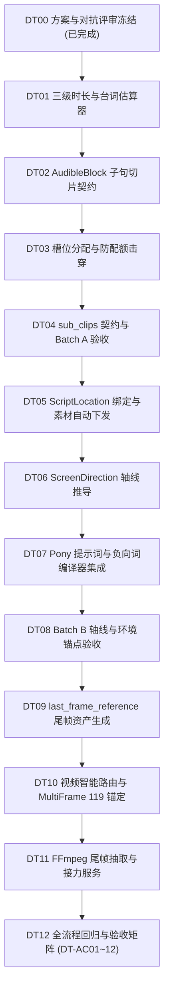

# 视听时长拆镜、场次视觉锚点与首尾帧接力任务清单 (2026-10-29)

配套方案：[shot_timing_visual_anchor_first_last_frame_spec_2026-10-29.md](./shot_timing_visual_anchor_first_last_frame_spec_2026-10-29.md)。  
概念与架构说明：[novel_to_script_to_storyboard_concepts.md](./novel_to_script_to_storyboard_concepts.md)、[scene_continuity_workflow_2026-10-09.md](./scene_continuity_workflow_2026-10-09.md)。  
全局进度与勾选状态维护于：[0_TASKLIST.md](../0_TASKLIST.md#track9-duration-anchor-relay)（Track 9）。

---

## 1. 任务全景与依赖关系 (Work Packages)

本轮开发拆解为三大批次、13 个原子任务（DT00 至 DT12），遵循“模型出语义/规格、代码管契约/门禁、测试保闭环”的工程标准：



| 工作包 | 包含任务 | 核心职责 | 主要改动文件 |
| :--- | :--- | :--- | :--- |
| **Batch A: 视听时长预算与自动拆镜** | DT01 ~ DT04 | 解除 15s 硬绑与单句报错；台词按句切片并保持原文；自动机位切分防止击穿 20% 特写配额。 | `storyboard_fact_workflow.ts`<br/>`shot_contract.ts`<br/>`storyboard_generation_service.ts` |
| **Batch B: 场次视觉锚点与 180° 轴线** | DT05 ~ DT08 | 分场地点自动写入 `scene_asset_reference`；正反打推导互斥站位与视线，锁死 180° 轴线。 | `script.ts`<br/>`shot_contract.ts`<br/>`pony_prompt_compiler.ts`<br/>`negative_prompt_compiler.ts` |
| **Batch C: 首尾双关键帧与接力管线** | DT09 ~ DT12 | 状态跃迁镜绑定首尾双静图；自动路由至 MultiFrame 24fps frame 119；FFmpeg 视频尾帧接力。 | `schemas/video.ts`<br/>`video_workflow_compiler.ts`<br/>`media_asset_service.ts`<br/>`assets.ts` |

---

## 2. 详细任务卡片与实施细则

### DT00 · 完成对抗式技术评审、规避设计与实施方案冻结 (已完成)
- **状态**：`[x]` 已完成。
- **交付内容**：
  1. 识别并解决 4 项架构冲突点（Reaction/Insert 击穿 20% 配额冲突、TTS `block_id` 音频映射脱节、H3 `FL2VA` 拒绝角色参考以及扩散模型坐标描述随机翻转问题）；
  2. 产出实施方案 `docs/architecture/shot_timing_visual_anchor_first_last_frame_spec_2026-10-29.md`；
  3. 建立本独立任务清单并同步索引至 `docs/0_TASKLIST.md` 与 `docs/README.md`。

---

### Batch A: 视听时长预算与长对白自动拆解

#### DT01 · 引入三级时长阈值与精细化台词估算器
- **依赖**：DT00。
- **落点**：`backend/src/services/storyboard_fact_workflow.ts`。
- **实现契约**：
  ```ts
  export const TARGET_SHOT_SECONDS = 5.0;
  export const SOFT_MAX_SHOT_SECONDS = 8.0;
  export const HARD_MAX_SHOT_SECONDS = 15.0;

  export function estimateAudioSeconds(block: { type: string; text: string; delivery?: string }): number {
    if (block.type !== 'dialogue' && block.type !== 'voiceover') return 0;
    const clean = block.text.replace(/\s+/g, '');
    if (!clean) return 0;
    const base = Math.max(1.0, clean.length / 3.8);
    const innerPunct = (clean.match(/[，,、；;]/g) || []).length * 0.15;
    const endPunct = (clean.match(/[。！？!?…—]/g) || []).length * 0.35;
    let factor = 1.0;
    if (block.delivery) {
      if (/缓慢|低沉|哽咽|迟疑|沉重|轻声|叹息/u.test(block.delivery)) factor = 1.2;
      else if (/急促|抢白|怒喝|快步|慌张/u.test(block.delivery)) factor = 0.85;
    }
    return Number(((base + innerPunct + endPunct) * factor).toFixed(2));
  }
  ```
- **验收标准 (AC)**：
  - 单测覆盖：短句（10字）、长句（50字）、多标点停顿、急促/缓慢语速修正；
  - 导出常数并在现有引用处替换原裸写 `15` 与 `spokenCharacters(block) / 4`。

#### DT02 · 扩展 AudibleBlockSchema 支持子句切片与音轨定位
- **依赖**：DT01。
- **落点**：`backend/src/schemas/shot_contract.ts`。
- **实现契约**：
  - 在 `AudibleBlockSchema` 中扩充可选字段：
    - `span_start?: number`
    - `span_end?: number`
    - `part_index?: number`
    - `part_total?: number`
    - `time_offset_ms?: number`
    - `duration_ms?: number`
  - 实现纯函数 `splitAudibleBlockIntoClauses(block, maxSeconds = 7.0)`，基于标点切分子句：
    - 优先在 `。！？\n` 处切分；次选在 `；—` 处切分；再次选在 `，、` 处切分；
    - 每个切片记录精准的 `span_start` 和 `span_end`（UTF-16 偏移）；
    - 实现反向校验函数 `assertAudibleSlicesAssemble(originalText, slices)`。
- **验收标准 (AC)**：
  - 80 字符长独白切分为 3~4 个子句，拼接后逐字等于原句；
  - 旧镜头 JSON 反序列化向后兼容，无报错。

#### DT03 · 重构镜头槽位分配算法，消除 >15s 报错与防配额击穿
- **依赖**：DT01、DT02。
- **落点**：`backend/src/services/storyboard_fact_workflow.ts`（`allocateBudgets`、`buckets` 装配）。
- **实现逻辑**：
  1. 移除 `if (longLine) throw new FactWorkflowError('声音预算冲突...')` 限制；
  2. `allocateBudgets` 中计算场景所需镜头数由 `Math.ceil(duration / 15)` 改为：
     $$\text{durationSlots} = \max\left(1, \lceil \text{duration} / \text{SOFT\_MAX\_SHOT\_SECONDS} \rceil\right)$$
  3. 当长台词产生额外 `hold_fact_ids` 槽位时：
     - 若出场角色数 ≥ 2（有听者）→ 分配 `shot_intent: 'medium-action'`（交替机位中景），**严禁默认全标为 reaction**；
     - 仅当整章 `insert + reaction` 占比严格低于 16% 时，才允许将 1 镜特写标为 `reaction`；
     - 若本分场有可见关键道具 → 允许将 1 镜标为 `insert`；
  4. 最终全章执行 `assertChapterShotQuota`，断言单镜时长 ≤ 8.0s，且 `insert + reaction ≤ 20%` 必须通过。
- **验收标准 (AC)**：
  - 单条 70 字对白（约 18s）正常生成候选，单镜时长在 4~7s 之间；
  - 章节配额校验一次通过，无报错。

#### DT04 · 支持可选的单镜长镜头切片契约（sub_clips）与 Batch A 验收
- **依赖**：DT03。
- **落点**：`backend/src/schemas/shot_contract.ts`、`storyboard_fact_workflow.test.ts`。
- **实现契约**：
  - 在 `ShotContractFieldsSchema` 增加 `sub_clips?: Array<ShotSubClip>`；
  - 编写集成测试套件，模拟完整 120s 短剧章节进行分镜拆解；
  - 验证全量 Batch A 测试（DT-AC01、DT-AC02、DT-AC03 全部通过）。

---

### Batch B: 场次环境主图继承与 180° 空间轴线契约

#### DT05 · 扩展地点资产关联并在采纳时自动下发环境参考
- **依赖**：DT04。
- **落点**：`backend/src/schemas/script.ts`、`backend/src/services/ai/storyboard_generation_service.ts`。
- **实现逻辑**：
  1. `ScriptLocationSchema` 扩展 `library_asset_id` 与 `master_revision`；
  2. 在 `applyStoryboardCandidate` 与局部采纳事务中，查询 `doc.locations`；
  3. 若当前分镜所属分场（`script_scene_id`）的 `locationId` 绑定了有效资产，自动向 `scene_asset_reference` 写入 `(scene_id, asset_id, asset_revision)`；
  4. 幂等与重做保证：替换旧镜头时，保留关联关系，不丢引用。
- **验收标准 (AC)**：
  - 分镜采纳后，数据库 `scene_asset_reference` 中能检索到该场所有镜头的场景素材绑定；
  - DT-AC04 通过。

#### DT06 · 在 ShotContract 中引入 screen_direction 与场内确定性轴线推导
- **依赖**：DT05。
- **落点**：`backend/src/schemas/shot_contract.ts`、`backend/src/services/storyboard_fact_workflow.ts`。
- **实现逻辑**：
  - 新增 `ScreenDirectionSchema`：
    ```ts
    export const ScreenDirectionSchema = z.object({
      subject_placement: z.enum(['left', 'center', 'right', 'two-shot-left-right']).optional(),
      facing_direction: z.enum(['left', 'right', 'camera', 'away']).optional(),
      camera_side: z.enum(['axis_a', 'axis_b']).default('axis_a'),
    });
    ```
  - 在分镜组装循环中，根据本场出场角色维护场内轴线状态机：
    - 主角/先发言者（角色 1）：`placement = 'left'`, `facing = 'right'`；
    - 对手/后发言者（角色 2）：`placement = 'right'`, `facing = 'left'`；
    - 双人同框镜：`placement = 'two-shot-left-right'`, `facing = 'camera'` 或对视；
    - 全场无越轴移动动词前，`camera_side` 锁定为 `'axis_a'`。
- **验收标准 (AC)**：
  - 纯函数推导，确定性输出，双人对话正反打镜头视线完全相反；
  - DT-AC05 通过。

#### DT07 · 将 screen_direction 接入 Pony 提示词与负向词编译器
- **依赖**：DT06。
- **落点**：`backend/src/services/pony_prompt_compiler.ts`、`backend/src/services/negative_prompt_compiler.ts`。
- **编译规则**：
  - 正向词在镜头合同后追加强动势标签：
    - `left + right` → `positioned on left side of frame, facing right, looking to the right`
    - `right + left` → `positioned on right side of frame, facing left, looking to the left`
  - 负向词追加：
    - `facing right` 时负向词排除 `facing left, looking left`；
    - 非 `facing camera` 时排除 `looking at viewer, front-facing passport photo`。
- **验收标准 (AC)**：
  - 编译后的英文提示词断言通过，无多余空格与标点错误；
  - DT-AC06 通过。

#### DT08 · 验收 Batch B 轴线与环境锚点闭环
- **依赖**：DT05 ~ DT07。
- **交付内容**：
  - 执行针对性单元测试与回归测试，验证轴线锁定与场景素材下发；
  - 验证通过，记录 Decision & Audit。

---

### Batch C: 首尾双关键帧生成与视频跨镜/子切片接力

#### DT09 · 镜头支持 last_frame_reference 尾帧静图资产绑定
- **依赖**：DT08。
- **落点**：`backend/src/schemas/video.ts`、`backend/src/routes/assets.ts`、`backend/src/services/generation_service.ts`。
- **实现逻辑**：
  1. 识别状态跃迁镜头（镜头包含 `phase = 'before'` 与 `phase = 'after'` 或跨节拍显著位移动作）；
  2. 首帧（`video_keyframe`）基于 `before` 生成；
  3. 提供尾帧生成通道，基于 `after` 状态，以首帧为底图（Reference / Img2Img Denoise 0.55）生成尾帧并存为 `media_asset (role = 'last_frame_reference')`；
  4. 双帧均调用 `validateShotMasterCharacters` 确保角色版本一致。
- **验收标准 (AC)**：
  - 数据库生成两张绑定的资产；角色校验一致；
  - DT-AC07 通过。

#### DT10 · 实现视频工作流智能路由与 MultiFrame 119 锚定
- **依赖**：DT09。
- **落点**：`backend/src/schemas/video.ts`、`backend/src/services/video/video_workflow_compiler.ts`。
- **实现逻辑**：
  - 实现 `resolveRecommendedVideoWorkflow(inputs)`：
    - `hasLastFrame && hasCharRef` → `minimax_h3_multiframe_official_12gb`；
    - `hasLastFrame && !hasCharRef` → `minimax_h3_fl2va_official_12gb`；
    - 其余默认 → `minimax_h3_ref2va_official_12gb`；
  - 在 MultiFrame 编译器中，自动将尾帧置于 `guide_frames: [{ asset_id: lastFrameId, frame_idx: 119 }]`。
- **验收标准 (AC)**：
  - 视频 Preflight 成功通过，返回预期 `workflow_id` 与预检参数；
  - DT-AC08、DT-AC09 通过。

#### DT11 · 实现跨镜/子切片尾帧抽取与接力服务
- **依赖**：DT10。
- **落点**：`backend/src/services/video/media_asset_service.ts`。
- **实现逻辑**：
  - 实现 `relayKeyframeFromPreviousShot(targetSceneId, sourceSceneId)`：
    - 检查源镜头是否存在已完成视频（`narrative_final`）；
    - 若有，调用 `ffmpeg` 截取最后 0.2 秒最优画质帧；
    - 保存并注册为目标镜头的 `video_keyframe`，设置 `parent_asset_id`；
    - 若上一镜有尾帧静态图，优先复用静态尾帧作为下一镜首帧（Keyframe Bridge 零画质衰减模式）。
- **验收标准 (AC)**：
  - 成功抽帧并落盘，下游镜头直接具备首帧，溯源完整；
  - DT-AC10 通过。

#### DT12 · 全流程回归与验收矩阵 (DT-AC01 ~ DT-AC12)
- **依赖**：DT01 ~ DT11。
- **交付内容**：
  - 完整回归 DT-AC01 至 DT-AC12；
  - 验证 `npm --prefix backend test` 全量通过；
  - 验证 `npm run typecheck` 0 错误；
  - 验证项目备份导出与导入无损还原新字段。

---

## 3. 验收矩阵与硬核断言表 (DT-AC01 ~ DT-AC12)

| 编号 | 测试用例与前置条件 | 预期观察到的行为与断言 |
| :--- | :--- | :--- |
| **DT-AC01** | 单条对白文本 72 字（约 18s），归属于单一分场 | 严禁抛出 `声音预算冲突: 单条语音超过 15 秒` 异常；系统自动按句切分挂载到 3 个连续镜头，各镜时长 4~7s，总时长守恒。 |
| **DT-AC02** | 包含 3 处长对白切镜的完整章节分镜生成 | 单镜时长均 ≤ 8.0s；自动生成的对话切镜优先记为 `medium-action`，章节配额校验 `insert + reaction ≤ 20%` 必须 100% 通过。 |
| **DT-AC03** | 跨镜对白子句还原性断言 | 连续镜头中 `AudibleBlock` 的各切片文本拼接还原后，与剧本正文 `block.text` 逐字相同（`hash` 100% 匹配）。 |
| **DT-AC04** | 剧本地点绑定 `library_asset_id` 后生成分镜并采纳 | 该场下生成的全部 `scene`，在 `scene_asset_reference` 表中均存在对应 `asset_id` 与 `asset_revision` 记录。 |
| **DT-AC05** | 双人对话分场生成分镜（角色 A 与角色 B 对峙） | 角色 A 单人镜为 `left + right`，角色 B 单人镜为 `right + left`；正反打视线方向绝对相反，不发生跳轴。 |
| **DT-AC06** | 带有 `screen_direction` 的镜头契约编译 Prompt | 正向词注入 `positioned on left... facing right`；负向词注入 `facing left, looking at viewer`。 |
| **DT-AC07** | 状态跃迁镜头（杯子完好 → 落地碎裂）生成首尾双帧 | 成功生成首尾两张静图，尾帧存为 `last_frame_reference`，并通过 `validateShotMasterCharacters` 校验。 |
| **DT-AC08** | 有尾帧且有出场角色的镜头进行视频 Preflight | 自动推荐并采用 `minimax_h3_multiframe_official_12gb`，尾帧锚定在 `frame_idx = 119`，角色参考图未被丢弃。 |
| **DT-AC09** | 纯空镜且有尾帧的镜头进行视频 Preflight | 自动推荐并采用 `minimax_h3_fl2va_official_12gb`，通过 FL2VA 校验。 |
| **DT-AC10** | 对已完成视频的镜头执行接力抽帧 | 成功提取尾帧画面，保存为下游镜头的 `video_keyframe`，`parent_asset_id` 记录正确。 |
| **DT-AC11** | 项目 JSON 备份导出与导入（带新契约字段） | 导出的 JSON 包含 `screen_direction` 与子句偏移；导入后所有关联关系与版本号无损还原。 |
| **DT-AC12** | 全栈静态检查与代码质量门禁 | `npm run typecheck` 0 错误；后端全量测试套件全绿；前端构建与生产打包 0 错误。 |
