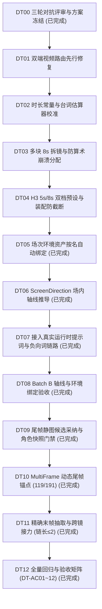

# 视听时长拆镜、场次视觉锚点与首尾帧接力任务清单 (2026-10-29 · v3 终局版)

配套方案：[shot_timing_visual_anchor_first_last_frame_spec_2026-10-29.md](./shot_timing_visual_anchor_first_last_frame_spec_2026-10-29.md)。  
概念与架构说明：[novel_to_script_to_storyboard_concepts.md](./novel_to_script_to_storyboard_concepts.md)、[scene_continuity_workflow_2026-10-09.md](./scene_continuity_workflow_2026-10-09.md)。  
全局进度与勾选状态维护于：[0_TASKLIST.md](../0_TASKLIST.md#track9-duration-anchor-relay)（Track 9）。

---

## 1. 任务全景与依赖关系 (Work Packages)

本轮开发拆解为三大批次、13 个原子任务（DT00 至 DT12），遵循“模型出语义/规格、代码管契约/门禁、测试保闭环”的工程标准：



| 工作包 | 包含任务 | 核心职责 | 主要改动文件 |
| :--- | :--- | :--- | :--- |
| **Batch A: 路由先行、5s/8s 双档时长与防冲突拆镜** | DT01 ~ DT04 | 双端修复带人物尾帧路由；建立 5s/8s 双档（120/192帧）与装配防截断；保持“一块一镜”，多块按 8s 扩槽、单长块由单镜包络防 L1197 崩溃。 | `services/videoWorkflowPolicy.ts`<br/>`scripts/production-references.mjs`<br/>`storyboard_fact_workflow.ts`<br/>`schemas/video.ts` / `full-production.mjs` |
| **Batch B: 场次环境按名绑定与 180° 轴线** | DT05 ~ DT08 | 采纳时按名绑定已完成 `location` 资产（不改 `ScriptLocation`）；从已确认绑定人物推导正反打互斥朝向并接入真实提示词编译链路。 | `storyboard_generation_service.ts`<br/>`shot_contract.ts`<br/>`english_visual_prompt.ts`<br/>`negative_prompt_compiler.ts` |
| **Batch C: 首尾双关键帧门禁与 8s 末帧接力** | DT09 ~ DT12 | 状态跃迁镜尾帧走候选采纳与快照校验；MultiFrame 动态锚定 119/191 帧；精确抽取末帧接力（限制链长 ≤ 2）。 | `shot_master_snapshot.ts`<br/>`video_workflow_compiler.ts`<br/>`media_asset_service.ts`<br/>`backend/scripts/run-tests.ts` |

---

## 2. 详细任务卡片与实施细则

### DT00 · 完成三轮对抗式技术评审、终局裁决与实施方案冻结 (已完成)
- **状态**：`[x]` 已完成。
- **交付内容**：
  1. 纠正“15s 模型物理上限”、“80% 伪配额”、“单块拆镜不拆块算术崩溃”、“8s 成片被装配 `-t` 截断”、“只改 `compilePonyPrompt` 无运行时效果”及“地点绑定污染剧本哈希”等架构隐患；
  2. 作出 4 项终局裁决（冻结单块单镜契约、确立 5s/8s 双档自动选择、仅从已确认绑定人物推导轴线、完成 120s 章节 21~25 镜预算核算）；
  3. 同步更新 `shot_timing_visual_anchor_first_last_frame_spec_2026-10-29.md`、本任务文档、`0_TASKLIST.md`、概念文档与连续性工作流文档。

---

### Batch A: 视频路由先行、5s/8s 双档时长模型与防冲突拆镜

#### DT01 · 修复前后端视频工作流路由策略（尾帧 + 人物参考 → Multi-Frame） (已完成)
- **状态**：`[x]` 已完成。
- **依赖**：DT00。
- **落点**：`services/videoWorkflowPolicy.ts`、`scripts/production-references.mjs`、`services/videoWorkflowPolicy.test.ts`、`scripts/full-production.test.mjs`。
- **实现逻辑**：
  1. 在 `recommendVideoWorkflow(assets)` 与 `chooseShotVideoStrategy(assets, override, projectDefault)` 中，当检测到就绪的 `last_frame_reference` 时：
     - 若同时存在就绪的 `character_reference`（或传入了角色参考），返回 `'minimax_h3_multiframe_official_12gb'`（并通过 `last_frame_asset_id` 传递尾帧，保留 `character_reference_asset_ids`）；
     - 仅当不存在人物参考时，才返回 `'minimax_h3_fl2va_official_12gb'`；
  2. 补齐前后端单测断言。
- **验收标准 (AC)**：**DT-AC01** 通过。

#### DT02 · 引入三级时长常量、校准台词估算器并升级 `FACT_POLICY_VERSION` (已完成)
- **状态**：`[x]` 已完成。
- **依赖**：DT01。
- **落点**：`backend/src/services/storyboard_fact_workflow.ts`、`backend/src/schemas/storyboard_facts.ts`。
- **实现契约**：
  1. 导出 `CLIP_SECONDS_SHORT = 5.0`、`SOFT_MAX_SHOT_SECONDS = 8.0`、`MAX_SHOT_SECONDS = 15.0`；
  2. 实现 `estimateAudioSeconds(block)`：保留 `spokenCharacters(block)`（仅统计对话引号内文字），将连续省略号 `……` 归并为单次句末停顿（`/[。！？!?—]|…+/g`），结合 `delivery` 语速系数（缓慢 1.2、急促 0.85）；
  3. 将 `FACT_POLICY_VERSION` 升级为 `'storyboard-facts-3.3'`。
- **验收标准 (AC)**：**DT-AC02** 通过。

#### DT03 · 剧本单块字数约束与分镜多块 8s 扩槽（防 L1197 算术崩溃与防配额击穿） (已完成)
- **状态**：`[x]` 已完成。
- **依赖**：DT02。
- **落点**：`backend/src/services/ai/script_generation_service.ts`、`backend/src/services/ai/prompt_registry.ts`、`backend/src/services/storyboard_fact_workflow.ts`、`backend/src/services/ai/storyboard_generation_service.test.ts`。
- **实现逻辑**：
  1. 在剧本生成 Prompt 中加入约束：单条 `dialogue` / `voiceover` 块控制在 **30 字（约 8 秒）以内**，长独白按完整句号拆为连续多个有声块；
  2. 在 `allocateBudgets` 中：
     - 保持“单块语音 > 15s 报错提示拆分有声块”的安全兜底；
     - 当分场包含多个有声块或多个独立视觉节拍时，按 `SOFT_MAX_SHOT_SECONDS (8.0s)` 计算所需槽位数，但槽位数不得超过本场独立视觉节拍数与有声块数的可分配上限，确保不会为单个 >8s 的有声块凭空拆出无声伴随槽位（彻底杜绝 L1197 `有声对齐时长冲突` 与静音空镜）；
     - 单镜时长上限维持 `MAX_SHOT_SECONDS (15.0s)`（供单块 8~15s 语音包络使用，成片靠 `tpad` 冻结尾帧）；
  3. 景别意图维持在 L1087 全章槽位冻结阶段分配，严守 `establish + wide-action >= 35%`、`insert + reaction <= 20%`、单一类型 `< 65%`。
- **验收标准 (AC)**：**DT-AC03** 通过。

#### DT04 · H3 5.0s / 8.0s 双档预设与生产装配器防截断修复 (已完成)
- **状态**：`[x]` 已完成。
- **依赖**：DT03。
- **落点**：`backend/src/schemas/video.ts`、`backend/src/services/video/video_spec_compiler.ts`、`backend/src/services/video/video_workflow_compiler.ts`、`backend/src/services/video/loop_closer.ts`、`scripts/full-production.mjs`。
- **实现逻辑**：
  1. `VideoPresetSchema` 新增 `'preview_480p_8s'` 与 `'standard_720p_8s'`；`resolvePresetDimensions` 对 8s 档返回 `frames: 192, delivery_frames: 192, fps: 24`；
  2. `video_workflow_compiler.ts` 与 `loop_closer.ts` 按预设动态校验 `124/120`（5s 档）或 `192/192`（8s 档）；
  3. `scripts/full-production.mjs` 在 `assemble()` 中读取 `clipSeconds = Number(info.format.duration) || 5`，令 `finalDuration = Math.max(layout.duration, clipSeconds)`，并用 `Math.max(0, finalDuration - clipSeconds)` 计算 `tpad=stop_mode=clone:stop_duration=...`，防止 8s 成片被 5~7s 语音截断。
- **验收标准 (AC)**：**DT-AC04** 通过。

---

### Batch B: 场次环境资产按名绑定与 180° 空间轴线契约

#### DT05 · 分镜采纳时按名自动绑定场次环境资产（不改动 ScriptLocationSchema） (已完成)
- **状态**：`[x]` 已完成。
- **依赖**：DT04。
- **落点**：`backend/src/services/ai/storyboard_generation_service.ts`。
- **实现逻辑**：
  1. **不向 `ScriptLocationSchema` 添加 `library_asset_id`**（避免更改剧本哈希导致全章事实契约失效）；
  2. 在 `applyStoryboardCandidate` 及分场局部采纳事务中，读取当前项目下 `status = 'completed'` 且有 `image_url` 的 `library_asset(kind = 'location')`；
  3. 按归一化名称（与 `scripts/production-references.mjs` `resolveAssetBindings` 一致）唯一匹配镜头 `spec.location`，自动向 `scene_asset_reference` 插入 `(scene_id, asset_id, asset_revision)`。
- **验收标准 (AC)**：**DT-AC05** 通过。

#### DT06 · 在 ShotContract 中引入 `screen_direction` 并基于已确认绑定人物推导轴线 (已完成)
- **状态**：`[x]` 已完成。
- **依赖**：DT05。
- **落点**：`backend/src/schemas/shot_contract.ts`、`backend/src/services/storyboard_fact_workflow.ts`。
- **实现逻辑**：
  1. 新增 `ScreenDirectionSchema`：
     ```ts
     export const ScreenDirectionSchema = z.object({
       subject_placement: z.enum(['left', 'center', 'right', 'two-shot-left-right']).optional(),
       facing_direction: z.enum(['left', 'right', 'each_other', 'camera', 'away']).optional(),
       camera_side: z.enum(['axis_a', 'axis_b']).default('axis_a'),
     });
     ```
  2. 在分镜组装循环中，严格依据本场视觉事实**已确认绑定（`boundVisibleEntities(f.binding)`）**的入镜人物推导：
     - 场内第 1 绑定交互角色单人镜：`placement = 'left'`, `facing = 'right'`；
     - 场内第 2 绑定交互角色单人镜：`placement = 'right'`, `facing = 'left'`；
     - 双人同框镜：`placement = 'two-shot-left-right'`, `facing = 'each_other'`（严禁用 `camera`，防止与 `looking at viewer` 负向词冲突）。
- **验收标准 (AC)**：**DT-AC06** 通过。

#### DT07 · 将 `screen_direction` 接入真实运行时提示词与负向词编译链路 (已完成)
- **状态**：`[x]` 已完成。
- **依赖**：DT06。
- **落点**：`backend/src/services/english_visual_prompt.ts`、`backend/src/services/scene_visual_prompt_service.ts`、`backend/src/services/negative_prompt_compiler.ts`（并同步 `pony_prompt_compiler.ts`）。
- **实现逻辑**：
  1. 在运行时真正生效的 `english_visual_prompt.ts` / `scene_visual_prompt_service.ts` 中注入朝向动势描述：
     - `left + right` → `positioned on left side of frame, facing right, looking to the right`
     - `right + left` → `positioned on right side of frame, facing left, looking to the left`
     - `two-shot-left-right + each_other` → `two characters facing each other across the frame, profile/three-quarter view`
  2. 在 `negative_prompt_compiler.ts` 中追加反向视线抑制词（`facing right` 排除 `facing left`；非 `camera` 排除 `looking at viewer, front-facing passport photo`）。
- **验收标准 (AC)**：**DT-AC07** 通过。

#### DT08 · Batch B 轴线与环境绑定闭环验收 (已完成)
- **状态**：`[x]` 已完成。
- **依赖**：DT05 ~ DT07。
- **交付内容**：完成双人正反打提示词/负向词单测与场次环境绑定集成测试，记录 Decision & Audit。

---

### Batch C: 首尾双关键帧门禁与 8s 整段末帧接力

#### DT09 · 状态跃迁镜尾帧（`last_frame_reference`）候选采纳与角色快照门禁 (已完成)
- **状态**：`[x]` 已完成。
- **依赖**：DT08。
- **落点**：`backend/src/routes/assets.ts`、`backend/src/services/video/shot_master_snapshot.ts`、`backend/src/services/video/video_generation_service.ts`。
- **实现逻辑**：
  1. 为状态跃迁镜头生成尾帧静图（`role = 'last_frame_reference'`）时，遵循候选→采纳流程，采纳时调用 `recordShotMasterSnapshot` 写入 `(scene_id, last_frame_url)` 的角色版本快照；
  2. 在 `video_generation_service.ts` 预检与提交时，对首帧（`shot.asset_url`）与尾帧（`lastFrameAsset.url`）双双执行 `validateShotMasterCharacters`，任一缺失或版本漂移均阻断。
- **验收标准 (AC)**：**DT-AC08** 通过。

#### DT10 · Multi-Frame 动态尾帧锚点（5s 档 119 / 8s 档 191）编译闭环 (已完成)
- **状态**：`[x]` 已完成。
- **依赖**：DT09。
- **落点**：`backend/src/schemas/video.ts`、`backend/src/services/video/video_workflow_compiler.ts`、`backend/src/services/video/video_spec_compiler.ts`、`scripts/production-references.mjs`。
- **实现逻辑**：
  1. 将 `guide_frame_idx` 与 `last_frame` 的帧位上限从写死的 `119` 扩展为按预设动态计算 `delivery_frames - 1`（5s 档为 `119`，8s 档为 `191`）；
  2. `video_workflow_compiler.ts` 节点 `23` 的 `frame_idx` 自动写入 `contract.delivery_frames - 1`（`119` 或 `191`），`video_spec_compiler.ts` 提示词同步输出对应帧号与秒数（`4.96s` 或 `7.96s`）。
- **验收标准 (AC)**：**DT-AC09** 通过。

#### DT11 · 精确末帧抽取与跨镜接力服务（限制接力链长 ≤ 2） (已完成)
- **状态**：`[x]` 已完成。
- **依赖**：DT10。
- **落点**：`backend/src/services/video/media_asset_service.ts`。
- **实现逻辑**：
  - 实现 `relayKeyframeFromPreviousShot(targetSceneId, sourceSceneId)`：
    1. 若源镜头存在已采纳的静态尾帧（`last_frame_reference`），优先直接复用该静态图（Keyframe Bridge 零 VAE 衰减模式）；
    2. 否则从源镜头已完成的 `narrative_final` 视频中，使用 `ffmpeg -vf "select=eq(n\,${deliveryFrames - 1})" -frames:v 1` 精确提取最后 1 帧；
    3. 检查源资产 `metadata_json.relay_depth`，若 `relay_depth >= 2` 则拒绝接力并要求重新生成静态关键帧（防多代 VAE 崩坏）；
    4. 注册为目标镜头的候选关键帧，记录 `parent_asset_id` 与 `relay_depth = (sourceDepth || 0) + 1`，采纳时同步写入 `scene_asset_image_snapshot`。
- **验收标准 (AC)**：**DT-AC10** 通过。

#### DT12 · 全流程回归与验收矩阵 (DT-AC01 ~ DT-AC12) (已完成)
- **状态**：`[x]` 已完成。
- **依赖**：DT01 ~ DT11。
- **落点**：`backend/scripts/run-tests.ts` 及全栈测试套件。
- **交付内容**：
  - 将所有新增单测文件登记进 `backend/scripts/run-tests.ts` 的 `CORE_TESTS`；
  - 验证项目备份导出与导入无损还原新字段（**DT-AC11**）；
  - 通过 `npm run check`、`npm --prefix backend run test:full`、`node --test scripts/full-production.test.mjs`（**DT-AC12**）。

---

## 3. 验收矩阵与硬核断言表 (DT-AC01 ~ DT-AC12)

| 编号 | 测试用例与前置条件 | 预期观察到的行为与断言 |
| :--- | :--- | :--- |
| **DT-AC01** | 有尾帧且有人物参考的镜头执行视频路由决策（前端与 CLI 双端） | `recommendVideoWorkflow` 与 `chooseShotVideoStrategy` 均返回 `minimax_h3_multiframe_official_12gb` 并携带 `last_frame_asset_id`，保留人物参考；纯空镜有尾帧返回 `fl2va`。 |
| **DT-AC02** | 台词时长估算器输入含引号对白、连续省略号 `……` 及急促/缓慢 `delivery` | 仅统计引号内可发音字符，连续 `……` 不重复计停顿；`FACT_POLICY_VERSION` 升至 `storyboard-facts-3.3`。 |
| **DT-AC03** | 多块长对白分场（总语音 18s）与单块 12s 对白分场分别执行预算与时长分配 | 多块长分场扩充为 3 镜（每镜 5~7s）；单块 12s 分场由单镜包络 12s（不抛 L1197 错误、无静音空镜）；120s 章节总镜数 <= 35，且 100% 通过 `assertChapterShotQuota`。 |
| **DT-AC04** | H3 `standard_720p_8s` 编译与 `full-production.mjs` 装配（8s 视频配 6s 语音 vs 11s 语音） | 8s 预设编译出 `frames = 192`、尾帧锚点 `191`；配 6s 语音时成片保持 `8.0s` 不截断；配 11s 语音时 `tpad` 冻结末尾 `3.0s` 至 `11.0s`。 |
| **DT-AC05** | 剧本分场 `location` 同名匹配已完成生图的 `library_asset(kind='location')` 并采纳 | 不修改 `ScriptLocationSchema`；采纳后 `scene_asset_reference` 自动写入对应 `(scene_id, asset_id, asset_revision)`。 |
| **DT-AC06** | 双人对话分场（已确认绑定角色 A 与角色 B）生成分镜契约 | 角色 A 单人镜为 `left + facing right`，角色 B 单人镜为 `right + facing left`，双人同框为 `two-shot-left-right + facing each_other`。 |
| **DT-AC07** | 带有 `screen_direction` 的镜头通过 `english_visual_prompt` 与 `negative_prompt_compiler` 编译 | 正向词注入朝向构图描述；负向词注入反向视线抑制词，且双人镜不与 `looking at viewer` 冲突。 |
| **DT-AC08** | 状态跃迁镜头生成尾帧静图并执行采纳与视频预检 | 尾帧采纳写入 `scene_asset_image_snapshot`，首尾双帧均通过 `validateShotMasterCharacters` 校验。 |
| **DT-AC09** | 5s 档与 8s 档下的 Multi-Frame 尾帧编译测试 | 5s 档尾帧锚定于 `frame_idx = 119`；8s 档尾帧锚定于 `frame_idx = 191`。 |
| **DT-AC10** | 对已完成视频的镜头执行 `relayKeyframeFromPreviousShot` | 精确抽取 `delivery_frames - 1` 帧，写入快照与 `parent_asset_id`；`relay_depth > 2` 时拒绝并提示生成新静图。 |
| **DT-AC11** | 项目 JSON 备份导出与导入（含 `screen_direction` 等新契约字段） | 导出 JSON 与导入还原无损，所有引用、快照与版本号完整保留。 |
| **DT-AC12** | 全栈静态检查与全量测试门禁 | 新增测试登记进 `run-tests.ts`；`npm run check`、`npm --prefix backend run test:full`、`node --test scripts/full-production.test.mjs` 全绿。 |
